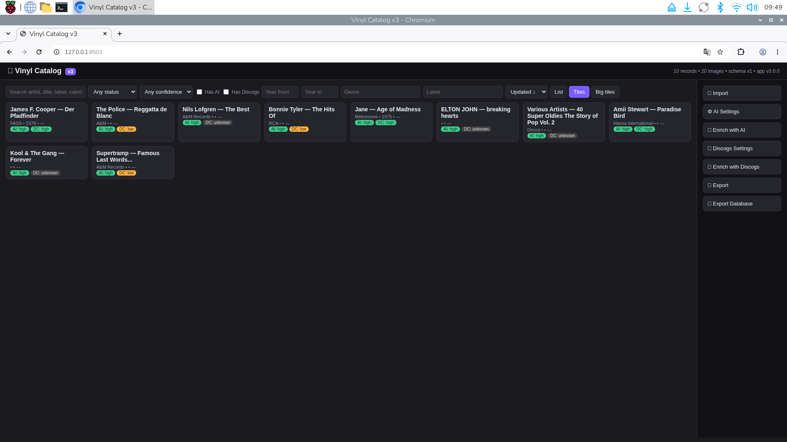

# Vinyl Catalog

**A private, self-hosted web app for cataloguing vinyl records from photos, enriching records with AI and Discogs, and backing up your collection.**

[](LICENSE) [](https://www.python.org/)

Vinyl Catalog runs on macOS, Windows, and Raspberry Pi. The app is hosted on your own computer or home network; your collection database and images are stored locally.

## Features

- Gallery-first collection with search, filters, sorting, list and tile views, and editable record details.
- Import image groups of 1–6 photos per record and label each photo (front, back, label A/B, inner sleeve, or other).
- AI enrichment with OpenAI, Anthropic, or Google Gemini, with provider/model controls and confidence explanations.
- Discogs lookup and candidate scoring; automatic selection only at score **60 or higher**, with manual selection otherwise.
- Export records to CSV, Excel, JSON, or printable HTML.
- Full database-and-images backup ZIP and restore.
- Local SQLite storage; no account or cloud service required for core cataloguing.
- Cross-platform Python app with no Node.js build step.

## Screenshots

Add release screenshots under [`docs/screenshots/`](docs/screenshots/). Suggested captures: collection gallery, record details with photo roles, import workflow, and enrichment settings. Use anonymized/sample records and remove personal information before publishing. Images will appear here when added:

<!-- Add images with e.g.  -->

## Requirements

- Python **3.10–3.12** and a supported macOS, Windows, or Linux installation.
- **Raspberry Pi 4 recommended** (64-bit Raspberry Pi OS); a USB SSD is useful for larger collections.
- **Raspberry Pi 3 is the absolute minimum**: it works, but expect slow imports, image processing, and general response times, especially with large libraries.
- Internet access is only required to install packages and when using AI providers or Discogs enrichment.

## Install and run

Download and unzip the project, then open a terminal/Command Prompt in the `vinyl-catalog-v3` folder.

### macOS / Linux / Raspberry Pi

```bash
chmod +x start.sh   # if needed
./start.sh
```

### Windows

Double-click `start.bat`, or run it from Command Prompt in the project folder:

```bat
start.bat
```

The start script creates a local `.venv`, installs dependencies, and starts the application on port **8501**. Open [http://127.0.0.1:8501](http://127.0.0.1:8501) on the same computer. On first startup, package installation requires internet access.

### Access from other devices on your LAN

The server listens on **`0.0.0.0`** (all network interfaces) so another device on your local network can connect. Find the host computer's LAN address (for example, the Pi's address from your router or `hostname -I` on Linux), then open `http://<pi-ip>:8501` from a phone or computer on the same network, replacing `<pi-ip>` with the actual address. Example: `http://192.168.1.25:8501`. Allow port 8501 through the host firewall if prompted. **Do not expose this development server directly to the public internet**; use it only on a trusted LAN. The listener is configured in `app/config.py` (`DEFAULT_HOST`) and used by `app/api/server.py`.

## Get API credentials (optional)

AI and Discogs features are optional. Configure credentials in the app's settings; do not put real credentials in source files or commit them to Git.

- **OpenAI:** create an API key in the [OpenAI API platform](https://platform.openai.com/api-keys).
- **Anthropic:** create an API key in the [Anthropic Console](https://console.anthropic.com/settings/keys).
- **Google Gemini:** create an API key in [Google AI Studio](https://aistudio.google.com/app/apikey).
- **Discogs:** generate a personal token at [Discogs Developer Settings](https://www.discogs.com/settings/developers).

Keys are saved in a settings file in the current user's local application-data directory (via `platformdirs`), not in the repository. Treat that file as a secret: it is stored locally and is not encrypted by this application. Outbound requests are made to the provider you select or to Discogs when you trigger enrichment. API usage may incur charges under the provider's terms; review model pricing and set provider-side spending limits. Discogs access is subject to Discogs rate limits and terms.

## Typical workflow

1. Start the app and open the gallery.
2. Use **Import** to select a folder of record photos. Choose 1–6 images per record and assign a role to each position; review grouping warnings before importing.
3. Review and edit records in the gallery/detail view.
4. Optionally configure an AI provider and/or Discogs token, then run enrichment for the desired records. Check confidence and confirm uncertain matches manually.
5. Export the collection or use the full backup ZIP to protect the database and images. Store backups separately from the device.

## Data and privacy

The database, managed images, and settings are stored in the per-user local application-data directory, not in the source tree. Exact location varies by OS; `platformdirs` chooses the directory. API credentials are written to local `settings.json` in plain text, protected only by the operating-system account/file permissions. Anyone with access to that account or file may be able to read them. Backups include collection data and images; keep backup archives private. AI/Discogs enrichment transmits the selected record metadata and, for AI, record photos to the configured third party. Do not send sensitive images or data unless you accept that provider's privacy terms.

## Project structure

```text
app/
  api/       FastAPI application and routes
  db/        SQLite schema and repository
  services/  import, jobs, grouping, thumbnails, exports
  ai/        AI provider integrations
  discogs/   Discogs API client and candidate scoring
templates/   HTML template
static/      CSS and browser-side JavaScript
tests/       pytest unit and API tests
data/        empty placeholder only; runtime user data is stored outside the repo
docs/        architecture, roadmap, and screenshots
start.sh     macOS/Linux/Raspberry Pi launcher
start.bat    Windows launcher
```

See [docs/ARCHITECTURE.md](docs/ARCHITECTURE.md) for component and data-flow details.

## Development and tests

```bash
python -m venv .venv
# macOS/Linux:
source .venv/bin/activate
# Windows PowerShell: .venv\Scripts\Activate.ps1
python -m pip install -r requirements-dev.txt
pytest -q
```

## Roadmap

See [ROADMAP.md](ROADMAP.md). Planned work includes Raspberry Pi 3 performance improvements, documented Pi LAN/systemd setup, immediate thumbnails in every gallery view, migration from v2 data, and expanded import workflows. These items are plans, not current guarantees.

## Contributing

Bug reports, feature ideas, documentation, and code contributions are welcome. Read [CONTRIBUTING.md](CONTRIBUTING.md) and [CODE_OF_CONDUCT.md](CODE_OF_CONDUCT.md) first. Use the GitHub issue templates for bugs and feature requests.

## License

MIT License. See [LICENSE](LICENSE).

## Keywords

vinyl collection, record collection, record catalog, LP catalog, music collection, Discogs, AI record recognition, Raspberry Pi, self-hosted, local-first, photo import, SQLite, Python, FastAPI
